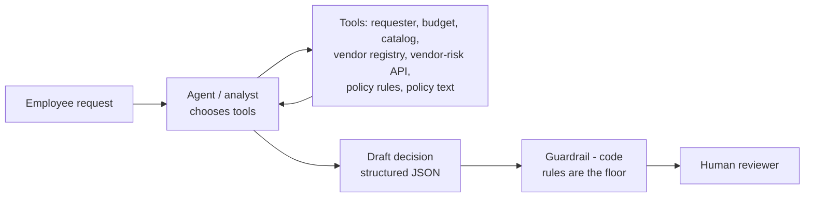

# AI Procurement Request Copilot

FDE Assessment 3. An internal tool that takes a software purchase request, gathers evidence (requester, budget, existing tools, vendor status, policy), and recommends the next action. Every decision stays with a person.

The whole thing is built around one split from the brief:

- **Code** does the parts that have to be right every time: approval thresholds, budget arithmetic, review dates, and the Security / Privacy / Legal triggers.
- **The LLM** interprets the request, decides what evidence to pull, judges whether an existing tool already covers the need, and writes the recommendation with citations.
- **A person** approves, rejects or asks for more. The copilot never buys anything, approves spend or touches a budget.

I built the two architectures the brief asks for, a single agent (A) and a staged analyst -> reviewer pipeline (B). I ran both on the same 17 cases, and the [decision memo](docs/decision_memo.md) explains which one I'd ship.

## Quick start

Python 3.11+.

```bash
python -m venv .venv
source .venv/bin/activate            # Windows: .\.venv\Scripts\Activate.ps1
pip install -r requirements.txt
cp .env.example .env                 # then put your GROQ_API_KEY in .env
python verify_setup.py               # should print PRE-FLIGHT PASSED

python run_local.py                  # one command: mock vendor-risk API on :8001 + UI on http://127.0.0.1:8501
```

The LLM is `openai/gpt-oss-120b` on Groq, called through the OpenAI-compatible API (`MODEL_NAME` / `LLM_BASE_URL` in `.env` can change it). If there's no key, or Groq is down, the app still runs. It returns the deterministic result flagged `ai_analysis_unavailable` instead of failing.

Other commands:

```bash
python -m unittest discover -s tests -v                    # 66 offline tests (no key needed, fake LLM)
python evals/run_public_evals.py --architecture single     # starter harness, 6 public cases
python evals/run_public_evals.py --architecture staged
python evals/compare.py                                    # full comparison -> evals/results/
```

Both eval scripts start the mock API themselves if it isn't already running.

## Using it

1. Pick one of the sample requests in the sidebar, or enter a new one with **New request**.
2. Choose architecture A or B and click **Run analysis**.
3. The right side shows the recommendation, the next step, the approvals required, risk flags, missing information, and anything the guardrail changed in the AI draft.
4. Below that are four evidence tabs. **Cited by AI** keeps only findings whose reference really came back from a tool. **Policy checks** shows the deterministic rule findings with policy sections. **Tool calls** has every call with its arguments and the raw result. **Raw output** is the full JSON.
5. A reviewer records their decision (send to approvers / return to requester / specialist review / reject) with a comment. It goes to `var/review_log.jsonl`. That's the human handoff; nothing else happens.

## How it works

Full diagrams, tool table, stop conditions and assumptions are in [docs/architecture.md](docs/architecture.md).



**Tools.** There are seven, and all are plain code. The model picks which to call and what to search the catalog for.

| Tool | What it does |
|---|---|
| `get_requester_profile` | employee, department, manager |
| `check_department_budget` | cost vs available budget (cost read from the request, never from the model) |
| `search_software_catalog` | catalog + purchase history; same vendor / category / capability |
| `get_vendor_registry_record` | internal vendor registry, review age vs the policy reference date |
| `get_vendor_risk_assessment` | the mock vendor-risk API; handles 404 and 503 without assuming anything |
| `check_policy_rules` | the deterministic policy engine (`src/rules.py`) |
| `read_policy` | exact text of a policy section |

**Grounding.** Every record a tool returns has a `ref` (`SW003`, `V005`, `budget:Marketing`, `vendor-risk:SignFlow`, `policy:§5` ...). The model has to cite refs, and an evidence item survives only if its refs actually came back from a tool in that run.

**Guardrail** (`src/guardrails.py`). The model can add approvals, flags and questions, but it can't drop what the rules require. It can't pick a less cautious next action than the evidence allows (missing info -> clarify, any specialist review / budget problem / unavailable or conflicting vendor data -> escalate), and it can't claim the request is already approved. Every change is listed in `guardrail_notes` and shown in the UI.

**Untrusted data.** Request text, vendor notes and API text are treated as data. A pattern screen flags instruction-like text (`prompt_injection_detected`), the tool result itself carries a warning when a note looks like an instruction, and the prompts tell the model to quote such text instead of following it. Even if all of that missed, the guardrail still wouldn't let an injected instruction remove a required review.

### Architecture A - single agent

One model, all seven tools, finishes with a `submit_decision` call that's validated against a JSON schema / Pydantic model. Up to 10 turns.

### Architecture B - staged

1. **Analyst** (5 data tools) gathers evidence and returns a structured evidence pack: need summary, per-tool "does this existing tool cover it", budget, vendor status, data, gaps / conflicts, suspicious text, cited evidence.
2. **Code** runs the policy engine.
3. **Policy / risk reviewer** (no data tools, one forced call) gets the request, the pack, the raw tool results, the policy check and the full policy, and returns the decision.

Same tools, rules and guardrail as A, so the comparison is only about how the LLM work is organised.

## Evaluation

I ran both architectures on the same 17 cases: the 6 public cases plus 11 of my own in `evals/extra_cases.json` (overlap, conflicting vendor data, >$25k, unknown vendor with no budget, injection in vendor notes, an unverified "Finance already said yes", vague requests, a vendor-risk outage). The extra cases are mostly the brief's "expect edge cases" list. There's also a third column, **rules**: just the deterministic engine with no LLM, as a reference point.

A case passes if the final output passes the starter's minimum checks (approvals, flags, missing info, human review) **and** has the expected next action. Same model for both (`openai/gpt-oss-120b`, temperature 0), 1 run per case. Full output is in [`evals/results/summary.md`](evals/results/summary.md), [`runs.csv`](evals/results/runs.csv), and one JSON per case in `evals/results/decisions/` with the model draft, the guardrail changes and the tool trace.

| Metric | A: single | B: staged | rules only |
|---|---:|---:|---:|
| Cases passing (checks + next action) | **15/17** | **15/17** | 15/17 |
| Next action right in the model's own draft (before guardrail) | 15/17 | 15/17 | n/a |
| Draft already had every required approval + flag | 17/17 | 16/17 | n/a |
| Runs where the guardrail had to change the next action | 0/17 | 1/17 | n/a |
| AI evidence items grounded in tool output | 138/139 (99%) | 120/129 (93%) | n/a |
| LLM errors / fallbacks | 0 | 0 | 0 |
| Avg latency | 9.2 s | 9.7 s | 0.05 s |
| Avg LLM calls | 7.1 | 7.2 | 0 |
| Avg tool calls | 5.9 | 6.2 | 0 |
| Avg tokens per request | 11.9k | 10.2k | 0 |

Latency excludes the time spent waiting on Groq's free-tier rate limit (avg 54 s per run for A, 68 s for B), which is recorded separately in `runs.csv`.

**What failed.** Both architectures missed the same two cases, and both were judgement calls, not policy ones:

- **EXT-03**: the requested product (TaskFlow) is already licensed company-wide with spare seats, so the answer should be "use the existing tool". A routed it for approval with a note to "confirm the need". B's analyst actually got it right (`covers_need: yes`, "fully covers the need"), but the reviewer still routed it and added a Privacy review the rules don't require. The guardrail treats that as a blocking review and escalated. So B lost the right answer in the handoff.
- **EXT-11**: the justification is "need this asap, thx". Both treated it as good enough and routed it, with a note about the existing SignFlow licence. Neither asked what it's for.

The rules column also scores 15/17 and fails the same two cases, because neither one can be decided by a threshold. So on this set, the model isn't what gets the next action right; the deterministic checks plus the guardrail already do that. What the model adds is the written recommendation, the cited evidence, the open questions, quoting injected text, and judgement calls like PUB-01, where A suggested using the existing tool instead of buying. But on the two cases built specifically to test judgement, neither architecture got it right.

**Where B was worse:**
- One draft dropped a required approval (Procurement on PUB-05), and the guardrail put it back.
- One handoff loss, EXT-03 above.
- More evidence dropped as ungrounded. 4 of B's 9 were valid policy refs that the model wrote as `policy:§N`, because the reviewer's input was JSON with `§` escaped. I fixed that after the run (`ensure_ascii=False`, and `normalize_ref` accepts the escaped form), but the numbers above are from before the fix. The other drops in both architectures cite a tool name instead of a record id. The guardrail is right to drop those.

**Where B was better:** about 15% fewer tokens, because the reviewer gets one compact input and doesn't run a tool loop.

**Caveat:** 1 run per case. EXT-03 passed for A in an earlier run on the same code, so the model's judgement on these borderline cases varies between runs. The numbers are good evidence that both architectures follow the policy, and weak evidence for anything finer than that.

To reproduce:

```bash
python evals/compare.py                 # all 17 cases x single / staged / rules
python evals/compare.py --resume        # only runs cases that have no saved result yet
```

A full run is about 34 LLM runs / ~380k tokens, which is more than the Groq free tier's 200k tokens/day for one model. When the daily limit runs out, `compare.py` stops cleanly and keeps what's finished, so it can be split over two days with `--resume`. That's how the results above were produced.

### Which one I'd ship

**A, the single agent.** Both architectures pass the same 15/17 and fail the same two cases. B adds a second prompt, a second schema and a handoff, and in return it got slightly slower, needed more guardrail corrections, and in EXT-03 dropped a correct finding between its stages. The safety comes from the deterministic rules and the guardrail, which both architectures share, not from splitting the LLM work in two. The reasoning is in the [decision memo](docs/decision_memo.md).

## Starter pack issues I fixed

The brief said the starter was a scaffold with problems to find. These are the ones I hit:

| Problem | Effect | Fix |
|---|---|---|
| `data_access.py` loaded CSVs with pandas defaults, so blank cells became `NaN` | `NaN` is truthy, so `if row["manager_id"]:` passed for an empty value, and date parsing crashed on missing review dates | blanks become `None` (`_read_csv`) |
| Mock API called `unquote()` on a path param FastAPI had already decoded | vendor names containing `%` were mangled (`Acme%41` -> `AcmeA`) | removed the second decode |
| `run_local.py` hardcoded port 8001 while the client read `VENDOR_RISK_BASE_URL` | changing the URL in `.env` made the app and the API silently disagree | launcher uses the port from the env URL |
| Streamlit's first-run "enter your email" prompt | `run_local.py` crashed (exit 255) on a machine that had never run Streamlit | `.streamlit/config.toml` runs it headless and binds it to 127.0.0.1 |
| `.gitignore` excluded `evals/results_*.csv` | the brief asks for evaluation results in the repo | removed that line; results live in `evals/results/` |
| `run_public_evals.py` needs the mock API but doesn't start it | without it every vendor looks unavailable and PUB-01 fails | the eval scripts start it when needed |

A few things I found in my own code during testing and fixed are in the git history ("harden tools and rules", "tool loop fixes found on first real runs").

## Assumptions

The main ones (full list in [docs/architecture.md](docs/architecture.md#assumptions)):

- All date checks use the policy's reference date, 2026-09-30, parsed from `procurement_policy.md`.
- `annual_cost_usd` is the amount used for thresholds; one-time costs are treated as annual.
- New vendor + `>= $10,000` -> Legal (§7 says "or more"), while the §4 tier boundaries are at `$10,000.01` and `$25,000.01`.
- If the vendor-risk service is down, Security has to verify even for a small request. §10 says not to assume a favourable result, so I fail closed.
- Overlap with the catalog is always flagged but never treated as a rejection. Whether it actually covers the need is the model's judgement.
- `human_review_required` is always `true`.

## Known limitations

- **The eval set is small**: 6 public + 11 of my own cases, 1 run each. That's enough to catch policy mistakes, but not enough to make precise claims about accuracy or variance.
- **Judgement cases are the weak spot.** Both architectures missed "an existing company-wide tool already covers this" (EXT-03) and "the justification is unusable" (EXT-11). A reviewer still sees the overlap flag and the existing licence in the evidence, but the suggested action is wrong.
- **My extra cases and expected actions are my own labels.** Two of them (PUB-01, EXT-08) accept more than one reasonable action.
- **Latency is measured on Groq's free tier.** The time spent waiting on the 8k tokens/min rate limit is recorded separately and excluded, but the remaining numbers will still differ on a paid tier.
- **The injection screen is a regex list.** It is a first line only; the real protection is that the guardrail never lets text remove a required review.
- **The rules use keyword matching** for data classes and integrations (for example "git", "production", "pii"). A hidden case with unusual wording could miss a Security trigger, though the model can still add it.
- **No approver resolution**: it says "Department Head", not who that is, and doesn't handle a requester approving their own request.
- **No seat-utilisation data**, so "is there spare capacity?" is raised as a question rather than checked.
- **The reviewer log is a local JSONL file**, with no auth.

## Repo layout

```text
app.py                  Streamlit UI
run_local.py            one-command start (mock API + UI)
src/
  solution.py           handle_request(request_id, architecture) - eval adapter
  pipeline.py           analyze_request(): toolbox -> agent(s) -> rules -> guardrail
  agents.py             architecture A (run_single) and B (run_staged)
  prompts.py            system prompts + submit_decision / submit_evidence_pack schemas
  llm.py                Groq client (OpenAI-compatible), tool loop, retry / rate-limit handling
  tools.py              the seven tools, ref tracking, caching
  rules.py              deterministic policy engine
  guardrails.py         merges the model draft with the rules
  injection.py          instruction-pattern screen
  contracts.py          ProcurementDecision (starter contract + a few optional fields)
evals/
  compare.py            same cases through each architecture -> evals/results/
  extra_cases.json      11 extra edge cases + expected next actions
  run_public_evals.py   starter harness
  results/              summary.md, runs.csv, decisions/<arch>/<case>.json
docs/
  architecture.md       diagrams, tools, guardrail, assumptions
  decision_memo.md      which architecture I'd ship (<= 500 words)
tests/                  unit tests (rules, tools, guardrail, agent loop with a fake LLM)
```
