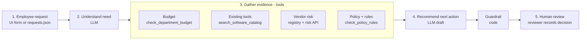
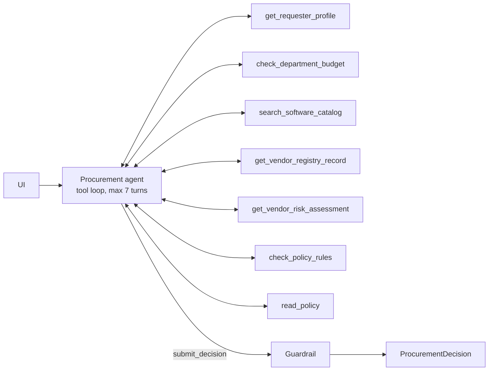
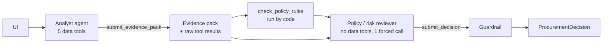

# Architecture, workflow and assumptions

## Workflow

The split I followed is the one in the brief:

| Who | Does what |
|---|---|
| **Code** | Required-field check, approval thresholds, budget arithmetic, review age vs the policy reference date, registry vs risk-service conflicts, Security / Privacy / Legal triggers, overlap candidates, an injection pattern screen, and the final guardrail. |
| **LLM** | Decides which evidence to fetch and what to search the catalog for, judges whether an existing tool actually covers the need, notices text that is trying to manipulate the review, chooses the next action, and writes the recommendation / next step with cited evidence. |
| **Human** | Every purchase decision. The copilot output always has `human_review_required: true`; the UI only records what the reviewer decided. |

## Architecture A - single agent (baseline)

One model with all seven tools. It finishes by calling `submit_decision` (a JSON-schema tool), which is validated with Pydantic; invalid payloads go back to the model with the validation error.

## Architecture B - staged / two agents

- **Analyst** only gathers and summarises. It returns a structured evidence pack: need summary, existing-tool fit (`yes / partly / no / unclear` per catalog ref), budget, vendor status, data and integrations, gaps or conflicts, suspicious content, and cited evidence.
- **Between the stages**, code runs the policy engine, so the reviewer always sees the deterministic results whether or not the analyst asked for them.
- **Reviewer** gets the request, the pack, the raw tool results, the policy check and the full policy text, and has to call `submit_decision`. It has no data tools, so it can't go fishing, and it is told to trust raw tool results over the analyst's summary.

Both architectures share the same tools, rules engine and guardrail. The only difference is how the model work is organised, which keeps the comparison fair.

## Tools

| Tool | Source | Deterministic? | Notes |
|---|---|---|---|
| `get_requester_profile` | employees.csv | yes | department, level, manager |
| `check_department_budget` | department_budgets.csv | yes | reads cost from the request itself, never from the model |
| `search_software_catalog` | software_catalog.csv + purchase_history.csv | yes (model picks the query) | empty query = same vendor / product / category |
| `get_vendor_registry_record` | vendors.csv | yes | review age computed against the policy reference date |
| `get_vendor_risk_assessment` | mock API `/vendor-risk/{name}` | yes | 404 -> "no assessment", 5xx / connection error -> `available: false`, one retry |
| `check_policy_rules` | src/rules.py | yes | approvals, flags, missing info, findings with policy section refs |
| `read_policy` | procurement_policy.md | yes | exact text of one section |

Every record a tool returns carries a `ref` (E004, SW003, V005, PO-2513, `budget:Finance`, `vendor-risk:SignFlow`, `policy:§5`, `request:annual_cost_usd`). The model has to cite these refs, and the guardrail keeps an evidence item only if every ref in it came back from a tool in that run.

## Guardrail (src/guardrails.py)

The model can add to the deterministic result, but it cannot take anything away:

- Required approvals and mandatory risk flags from `check_policy_rules` are merged in if the draft left them out. Approver names outside the eight policy roles are dropped.
- "Missing information" from the model is only kept for the two §1 fields that need judgement: whether the business purpose and the data class are actually usable. Anything else becomes an open question, so the model can't block a request over a nice-to-have.
- Evidence citing refs that no tool returned is removed.
- The next action can't be less cautious than the evidence allows. Missing information forces `request_clarification`, and a Security / Privacy / Legal review, a budget problem, an unavailable risk service or conflicting vendor evidence forces `escalate_for_review`.
- Text claiming the request is already approved is replaced.
- `human_review_required` is always true.
- Every change is listed in `guardrail_notes` and shown in the UI, and the eval counts them per architecture.

If the LLM is unavailable (no key, API error, or no valid output after the turn limit), the same rules produce a deterministic decision flagged `ai_analysis_unavailable` instead of an error.

## Stop / escalation conditions

| Condition | Result |
|---|---|
| Any §1 field missing (cost, users, data class, purpose, requester, vendor, integrations) | `request_clarification` |
| Security / Privacy / Legal triggered | `escalate_for_review` |
| Cost above available budget, or no budget record for the department | Finance + `escalate_for_review` |
| Vendor-risk service down or no record | Security verification + `escalate_for_review` |
| Registry and risk service disagree | `conflicting_vendor_evidence`, Security + `escalate_for_review` |
| Instruction-like text in request or vendor data | `prompt_injection_detected`; the instruction is ignored and the normal rules still apply |
| Model stuck (7 turns single, 6 + 2 staged) | deterministic fallback |

## Assumptions

1. `annual_cost_usd` is the annualised amount used for thresholds. A one-time cost (REQ-1010) is treated as its annual amount.
2. The budget comes from the requester's department in the employee directory, not from anything typed in the request.
3. If the cost is unknown, the approval tier can't be set. Only Procurement is listed (to triage) until the requester supplies it.
4. "New vendor" means the vendor is missing from the registry or its procurement status isn't `Approved`. Legal applies at `>= $10,000` for new vendors (§7 says "or more"), while the §4 tiers start at `$10,000.01`.
5. A review is current for 365 days counted against the policy reference date (2026-09-30). A missing or future-dated review counts as not current.
6. A conflict means the registry and the risk service disagree on approved vs not approved, or carry different review dates.
7. Security integration triggers are keyword based (git / repositories with source code, production, cloud account, database, credentials or secrets). SSO alone is not treated as a production integration.
8. For §6, "sensitive data" means PII, confidential documents, source code or credentials. Production telemetry is a Security trigger but not a data-residency one.
9. When the vendor-risk service is down, Security verification is required even for low-risk requests. §10 says not to infer a favourable status, so I chose to fail closed.
10. Overlap is flagged whenever the catalog has the same vendor, product or category. It means "review this", not "reject". Whether the existing tool really covers the need is the model's call.
11. `human_review_required` is always true, because §11 keeps every approval with a person.

## What I did not build

- No purchasing, approval or budget write-back. The reviewer decision is only appended to `var/review_log.jsonl`.
- No named approver resolution (for example finding the actual Department Head, or handling a requester who is the head of their own department).
- No authentication or roles in the UI.
- No seat-utilisation data, so "is there unused capacity?" is raised as an open question rather than checked.
- No third agent. The brief caps it at two, and the results didn't suggest one was needed.
